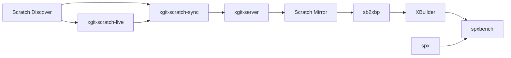
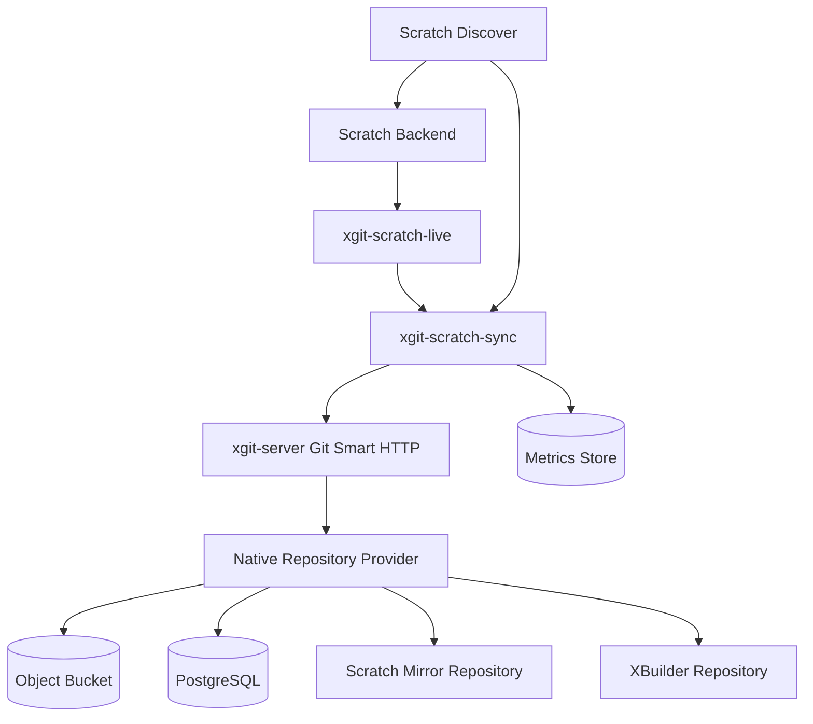

# xgit-server

xgit-server 的第一目标是建设一个 **Scratch Mirror**，为 XBuilder 和 SPX 的大规模回归测试提供持续、可版本化的 Scratch 项目数据。

整体链路如下。



## 1. 为什么需要 Scratch Mirror

XBuilder 当前项目数量有限，难以覆盖 XBuilder 编辑器、项目加载、Scratch 转换和 SPX 运行时的真实输入。

我们需要大量真实 Scratch 项目，经过 `sb2xbp` 转换为 XBuilder 的 XBP 格式，再交给 `spxbench` 使用 XBuilder 游戏引擎和 SPX 运行时执行回归测试。

```text
Scratch project
  -> Scratch Mirror
  -> 展开后的 SB2/SB3 项目
  -> sb2xbp
  -> XBP
  -> XBuilder / spx
  -> spxbench 回归测试
```

相关项目如下。

- [XBuilder](https://github.com/goplus/builder)
- [sb2xbp](https://github.com/goplus/sb2xbp)
- [spxbench](https://github.com/goplus/spxbench)
- [spx](https://github.com/goplus/spx)

## 2. 当前 spxbench 的方式

当前 `spxbench` 通过 GitHub Actions 定时或手动运行 Scratch workflow。

主要过程如下。

1. 从 Scratch Explore API 获取热门项目列表，默认处理前 50 个项目。
2. 读取项目元数据并获取 `projectToken`。
3. 下载项目 `project.json`。
4. 根据 `project.json` 中的资源引用下载图片、声音等资产。
5. 可选地使用固定版本的 Scratch VM 重新序列化 `project.json`。
6. 生成增量 plan，跳过已经处理的项目。
7. 上传 SB2/SB3 到 Kodo。
8. 调用 `sb2xbp` 转换成 XBP。
9. 将项目导入 XBuilder 或提交给 SPXBench。
10. 更新同步状态和任务结果。

当前 workflow 仍然以热门项目和 Kodo 状态文件为中心。它可以增量处理项目，但不具备以 Git commit 形式保存完整项目历史的能力。具体接口见 [Scratch API](docs/api/scratch.md)，当前流程见 [spxbench Scratch workflow](https://github.com/goplus/spxbench/blob/main/.github/workflows/scratch.yml)。

## 3. Scratch Mirror 的目标

Scratch Mirror 将 Scratch 项目转换为可以通过 Git 访问的版本化项目仓库。

每个 Scratch 项目对应一个仓库，仓库中保存展开后的项目文件。

```text
project.json
<asset-id>.png
<asset-id>.svg
<asset-id>.wav
<asset-id>.mp3
source/project.json
source/version.json
```

目标包括：

- 保存项目的所有可获得历史版本
- 对每个版本生成稳定的 Git commit
- 对资源按内容 hash 去重
- 让 `sb2xbp` 可以直接从某个 commit 获取输入
- 让 spxbench 可以固定测试数据版本
- 支持按作者、项目 ID、版本和更新时间查询
- 支持新项目发现和已有项目变更发现
- 保存项目互动数据的历史变化曲线

Git 用于项目快照和版本历史。点赞、收藏、浏览等高频数据进入单独的指标存储。

## 4. 总体架构



### Scratch Live

`xgit-scratch-live` 负责访问当前 Scratch 后端，并把 Scratch 项目包装为只读 Git remote。它可以独立仓库维护，隔离 Scratch 后端凭据、接口变化和限流策略。

### Scratch Discover

Scratch Discover 发现新项目和项目变化，并向 Scratch Sync 发送任务。它不负责完整下载和转换项目。

### Scratch Sync

Scratch Sync 从 Scratch Live 拉取项目，再写入 xgit-server 的 Native Repository。

第一阶段可以使用 Git fetch/clone 加 Git push 验证协议链路。生产模式建议直接使用 Source API 获取版本和资源，以保留 source cursor、source version ID 和同步幂等状态。

### xgit-server

xgit-server 提供通用 Git Smart HTTP 和自有仓库存储。Scratch Mirror 与 XBuilder 项目都使用同一个 Native Repository Provider。

### XBuilder 与 spxbench

Scratch Mirror 的 Git commit 作为 `sb2xbp` 的输入版本。转换生成的 XBP 可以写入 XBuilder，再由 spxbench 调用 XBuilder 和 SPX 执行测试。

## 5. Git remote 路径

路径中的作者名和项目 ID 用于定位外部项目。项目标题不作为仓库身份，避免标题修改导致 remote 变化。

```text
https://scratch-live.io/{author}/{projectID}.git
https://scratch-mirror.io/{author}/{projectID}.git
https://xbuilder.io/{author}/{projectID}.git
```

域名可以变化，控制面返回的 canonical remote 作为客户端使用的最终地址。

三类地址都使用 Git Smart HTTP。

- `scratch-live.io` 的 backend 是 Scratch Live Provider
- `scratch-mirror.io` 的 backend 是 xgit-server Native Repository
- `xbuilder.io` 的 backend 是 xgit-server Native Repository 加 XBuilder 业务投影

## 6. 文档导航

这份 README 是总设计文档。实现细节按链路拆分。

- [Scratch API](docs/api/scratch.md) 记录当前 spxbench 使用的 Scratch 元数据、项目和资源接口
- [Scratch Live](docs/scratch-live.md) 记录如何把 Scratch 后端包装成 Git remote
- [Scratch Discover](docs/discovery.md) 记录如何发现新项目和项目变化
- [Scratch Sync](docs/sync.md) 记录同步服务 API、clone/push 流程和任务内部行为
- [xgit-server](docs/xgit-server.md) 记录 Git server、存储、模块和接口
- [XBuilder integration](docs/xbuilder.md) 记录 Scratch 项目如何进入 sb2xbp、XBuilder 和 spxbench
- [Operations](docs/operations.md) 记录部署、状态、重试、监控和数据恢复

